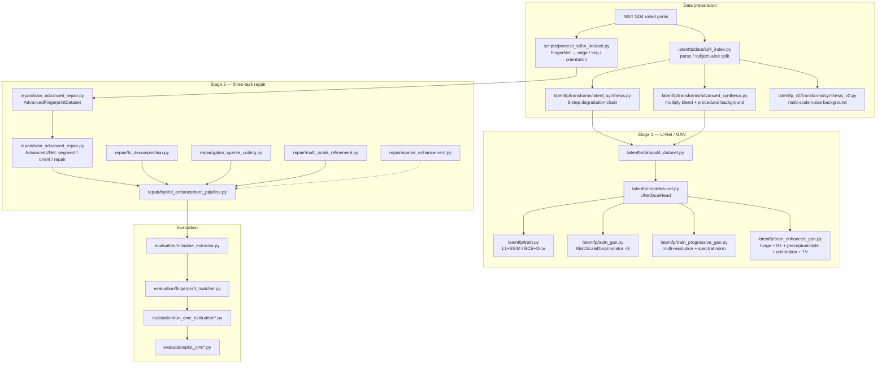

# Latent Fingerprint Enhancement · degradation synthesis + dual-head U-Net / multi-scale GAN + TV–Gabor sparse coding

**简体中文** | [English](README.en.md)


> A latent fingerprint is the partial, low-contrast, background-contaminated fingerprint lifted
> from a surface. Enhancement means reconnecting broken ridges, suppressing the background, and
> producing something a minutiae extractor can actually use.
>
> This repository is the whole pipeline: **synthesise training pairs by degrading clean rolled
> prints, learn the `latent → clean ridge` mapping with a dual-head U-Net and three progressively
> heavier GAN variants, then apply a training-free TV + Gabor-dictionary sparse-representation pass**,
> and finally score the result with Rank-k / CMC curves on NIST SD4.

---

## Why it is built this way

There are three families of latent-enhancement methods and they fail differently. All three are
implemented here so they can be compared on the same data — not because one of them "wins":

| Approach | Module | Fixes | Does not fix |
| --- | --- | --- | --- |
| Discriminative regression (L1/MSE) | `latentfp_v2/` | broken ridges, global contrast | output is over-smooth; ridge width near minutiae blurs away |
| Conditional GAN (PatchGAN) | `latentfp/train_gan.py` | local texture sharpness | unstable training, hallucinated texture on flat background |
| Multi-resolution discriminator + perceptual/style/orientation losses | `latentfp/train_progressive_gan.py`, `latentfp/train_enhanced_gan.py` | multi-scale texture consistency, high-level similarity, ridge-orientation continuity | depends on ImageNet VGG (domain shift to grayscale fingerprints); the orientation field itself is gradient-estimated, so it is unreliable in noisy regions |
| Three-task joint U-Net | `repair/train_advanced_repair.py` | segmentation / orientation / repair constrain each other; the repair head stops inventing ridges in the background | needs FingerNet to produce segmentation and orientation labels first |
| Training-free gradient-domain methods | `repair/tv_decomposition.py`, `repair/gabor_sparse_coding.py`, `repair/sparse_enhancement.py` | no dataset needed, controllable and interpretable | very slow (one Lasso/OMP per patch), sensitive to its parameters |

**Why the data has to be synthesised.** Public real-latent databases (NIST SD27, CACD) hold only a
few hundred images and provide no pixel-aligned "clean" ground truth. So this repo follows the
standard trick: take the clean rolled prints from NIST SD4 as `clean`, degrade them with a known
forward model (contrast compression, gamma, motion blur, Gaussian/speckle noise, occlusions,
vignetting) to get `latent`, and `(latent, clean)` becomes an unlimited supply of pairs.

**Why a non-deep stage is kept.** GAN output frequently "invents" ridge connections that were never
there, and invented connections become false minutiae — exactly what a fingerprint matcher must not
see. The TV + Gabor-dictionary stage only reconstructs structure that exists in the dictionary, so it
cannot hallucinate ridges; the price is speed. The trade-off is spelled out under *Known limitations*.

---

## Architecture



**Key data-flow detail.** `repair/` does not synthesise latents itself: it consumes the four aligned
directories produced by `scripts/process_sd04_dataset.py` (`original/`, `enhanced_binary/`,
`segmentation/`, `orientation/`). `latentfp/` and `latentfp_v2/` synthesise **online** — every epoch
sees a fresh random degradation, which is effectively infinite augmentation.

---

## Modules

### Latent synthesis (no training required)

| Module | File | Role | Key implementation |
| --- | --- | --- | --- |
| Degradation chain v1 | `latentfp/transforms/latent_synthesis.py` | clean print → latent | 8 chained ops (contrast/brightness → gamma → Gaussian blur → motion blur → Gaussian noise → speckle → rectangular occlusions → vignette), then a global contrast squeeze `α∈[0.5,0.9]`, `bias∈[-0.1,0.1]`; each op has its own trigger probability |
| Ridge map | same, `estimate_ridgemap` | binary ridge skeleton as auxiliary supervision | CLAHE(2.0, 8×8) → 3×3 Gaussian → adaptive threshold (`GAUSSIAN_C`, block 15, C=2, `THRESH_BINARY_INV`) → morphological thinning |
| Multiply-blend synthesis | `latentfp/transforms/advanced_synthesis.py` | "finger pressed on a textured object" | `multiply_blend` per-pixel product against a procedural background (uniform noise + random diagonal stripes + rings + random blocks) |
| Degradation chain v2 | `latentfp_v2/transforms/synthesis_v2.py` | gentler, more stable | four upsampled random noise scales summed into a Perlin-like background, then multiply blend, contrast compression, mild blur and noise |
| Patch bookkeeping | `latentfp/transforms/patch_ops.py` | accumulate & average overlapping patches | `accumulate_patch` + `weighted_average`; pixels no patch covered fall back to the original image |
| SD4 index | `latentfp/data/sd4_index.py` | name parsing, pairing, **subject-wise split** | `f0001_01.png` → `("f","0001","01")`; `split_subjects` is seeded from `sha256(salt:seed)` so two impressions of one subject never straddle train/val |

### Models and losses

| Module | File | Role | Key implementation |
| --- | --- | --- | --- |
| Dual-head U-Net | `latentfp/models/unet.py` | generator backbone | 4 down-samples (base 32→512), bilinear up-sample + skip concat, two 1×1 heads: `restored` (logits) and `ridge_logits` |
| Multi-scale discriminator | `latentfp/models/discriminators.py` | PatchGAN | `MultiScaleDiscriminator` runs a `PatchDiscriminator` (4×4 conv, stride 2) at 1×, 1/2 and 1/4 scale |
| Multi-resolution discriminator | `latentfp/models/progressive_discriminators.py` | more stable | full-resolution path plus 1/2 and 1/4 sub-discriminators, all `spectral_norm`, **BatchNorm removed** (more stable at small batch sizes) |
| Plain regression | `latentfp/train.py` | ablation baseline | `loss = [L1 + 0.2·SSIM] + 0.5·[BCE + 0.5·Dice]`, Adam 1e-3, cosine annealing, AMP |
| Conditional GAN | `latentfp/train_gan.py` | baseline #2 | BCE-with-logits adversarial + `λ_l1=100`, `λ_ssim=20`, `λ_ridge=1.0`; the discriminator sees `[latent, restored]` concatenated on the channel axis |
| Multi-resolution GAN | `latentfp/train_progressive_gan.py` | baseline #3 | the three scale-wise adversarial losses are **averaged**, not summed |
| Full "paper-style" GAN | `latentfp/train_enhanced_gan.py` | everything stacked | hinge GAN + R1 gradient penalty (`γ=10`) + VGG16 perceptual/style + orientation-field loss + TV + Dice; weights `{l1:100, perceptual:10, style:10, orientation:5, tv:0.1, dice:10}`; separate `GradScaler` for D and G; adversarial warm-up over the first 10 % of epochs; whole batch skipped on non-finite loss |
| Perceptual / orientation loss | `latentfp/losses/perceptual_loss.py` | high-level + geometric constraints | `VGGPerceptualLoss` takes VGG16 layers 4/9/16 for L1 plus a Gram style term; `OrientationFieldLoss` computes `gx, gy` with Sobel, smooths `gxx/gyy/gxy` with a 15×15 box, then `θ = 0.5·atan2(2Gxy, Gxx−Gyy)`, L1 between the two orientation fields plus a coherence term |
| Metric reference | `latentfp/losses/metrics.py` | testable maths | integral-image `box_filter`, `ssim_map/ssim_loss`, `dice_coefficient/dice_loss`, `psnr`, `normalize_weights`, `combine_losses`; torch variants imported on demand |
| Single-stage v2 | `latentfp_v2/models/enhance_unet.py` | minimal baseline | same 4-level U-Net, up-sampling pads to the skip size; loss is just `L1(sigmoid(rec), clean) + Dice(ridge_logits, ridge)` |
| Three-task repair net | `repair/train_advanced_repair.py` | main model | 4-level encoder → `AttentionBlock` at the 1/16 bottleneck (channel-reduced Q/K self-attention + learnable `γ` residual) → shared decoder → three heads: `segment` (Sigmoid), `orient` (Tanh), `repair` (Tanh); loss `200·BCE + 50·L1(orient) + 100·(L1 + 0.5·EdgeLoss)` |
| VGG perceptual loss | `repair/perceptual_loss.py` | second perceptual implementation | VGG16 relu1_2/relu2_2/relu3_3/relu4_3, features L2-normalised per channel before L1; `EnhancedLoss = λ_mse·MSE + λ_p·perceptual` |

### Gradient-domain enhancement (TV + Gabor sparse representation)

| Module | File | Role | Key implementation |
| --- | --- | --- | --- |
| TV decomposition | `repair/tv_decomposition.py` | split image into "structure/background" and "texture/ridges" | three solvers: gradient-descent, ROF, and an adaptive-λ variant driven by `compute_coherence` (structure-tensor coherence `√((Gxx−Gyy)²+4Gxy²)/(Gxx+Gyy)`) |
| Gabor dictionary | `repair/gabor_sparse_coding.py` | dictionary for sparse coding | **16 orientations × 9 wavelengths (5…21 px) × 6 phases = 864 atoms**, each zero-mean and L2-normalised; `Lasso`/`OMP` coding with `fit_intercept=True` to absorb the DC term |
| Multi-scale sparse coding | same, `multi_scale_sparse_coding` | paper-style eq. (9) joint problem | stack `[Φ_s ; √γ·Φ_l]` and `[y_s ; √γ·y_l]`, solve once, reconstruct with the **small** dictionary; `γ=0.8` |
| Multi-scale refinement | `repair/multi_scale_refinement.py` | repair only the low-quality regions | `quality_assessment` locates low-coherence patches; patch side grows 24→48 in steps of 4 |
| Hybrid pipeline | `repair/hybrid_enhancement_pipeline.py` | glue | `HybridFingerprintEnhancer.enhance(method=...)` supports `tv_only / unet_only / gabor_only / tv_gabor / unet_gabor / unet_tv_gabor / full`; `full` = TV → U-Net → contrast stretch → multi-scale sparse → iterative refinement |
| Band-guided sparse enhancement | `repair/sparse_enhancement.py` | a finer take on the same method | structure tensor gives the patch's dominant orientation; a `cv2.remap` profile along the normal plus `rfft` gives the wavelength; those pick an orientation ±15° / wavelength ±2 px sub-dictionary out of the 864 atoms before joint two-scale coding; also does sparse-coefficient segmentation |

### Inference and evaluation

| Module | File | Role | Key implementation |
| --- | --- | --- | --- |
| Inference (v1) | `latentfp/infer.py` | three output images | accepts `{"model":...}`, `{"generator":...}` or a bare `state_dict`; writes `restored.png`, `ridge.png`, `ridge_bin.png` (Otsu) |
| Inference (v2) | `latentfp_v2/infer_v2.py` | same, simpler | loads with `strict=False`, same three outputs |
| Batch inference | `repair/inference_advanced.py` | three-task model, batch | infers `base_channels` from the first checkpoint layer; restores the original resolution |
| Output & metrics | `repair/output.py` | batch output + PSNR/SSIM | `skimage.metrics` for PSNR/SSIM, optional Otsu / fixed-threshold binarisation |
| Binarisation | `repair/binarize_enhanced_images.py` | enhanced → pure black/white | Otsu / fixed / adaptive threshold + morphology, then mask by the segmentation map |
| Minutiae | `evaluation/minutiae_extractor.py` | endpoints / bifurcations | `skimage.morphology.thin` skeleton → 8-neighbour crossing number `CN`; `CN==1` endpoint, `CN==3` bifurcation; points within 20 px of the border are dropped |
| Matching | `evaluation/fingerprint_matcher.py` | minutiae comparison | `scipy.spatial.distance.cdist` cost matrix + `scipy.optimize.linear_sum_assignment` (Hungarian), `distance_threshold=20 px`, `angle_threshold=π/6`; `MatcherWithTransform` adds an angle search |
| CMC | `evaluation/run_cmc_evaluation{,_fast,_medium}.py` | Rank-k curves | score every probe against the whole gallery → sort → look up the rank of the true mate → Rank-k; minutiae cached as pickle |
| Plots | `evaluation/plot_cmc.py`, `plot_cmc_4panel.py` | CMC curves | single-panel / four-panel from the JSON results |

---

## How NIST SD4 is used

NIST Special Database 4 is 2000 pairs: one rolled (classifiable) tenprint plus its matching **latent**
print, sharing a four-digit subject id and a two-digit impression id:

```
f0001_01.png   # rolled / classifiable print
s0001_01.png   # matching latent / search print
```

The repository uses that naming two ways:

1. **Clean images only** (`latentfp/`, `latentfp_v2/`)
   Point `--data_root` at any directory of clean print PNGs. `SD4Fingerprints` does
   `rglob("*.png")`, random-crops 256 (reflect-padded when smaller; `train_enhanced_gan.py` uses 512),
   and synthesises both `latent` and `ridge` on the fly. `latentfp/data/sd4_index.py` additionally
   provides filename parsing and a **subject-wise** train/val split so the two impressions of one
   finger never end up on opposite sides.
2. **Four aligned directories** (`repair/`)
   `scripts/process_sd04_dataset.py` runs FingerNet over `png_txt/figs_*` and writes:

```
processed_sd04_dataset/
├── original/          # input: raw latent
├── enhanced/          # FingerNet phase image (ridges)
├── enhanced_binary/   # binarised ridges — the training target used by repair/
├── segmentation/      # foreground mask
├── orientation/       # orientation field (encoded as 0-255 grey for visualisation)
└── paired_list.txt
```

> ⚠️ `scripts/process_sd04_dataset.py` depends on the **third-party FingerNet Keras release**
> (`src/train_test_deploy.py`, `src/utils.py`, `models/released_version/Model.model`). Those files are
> governed by their original licence and are **not** part of this repository; you need your own
> FingerNet checkout before this script can run.

---

## Quick start

```bash
git clone https://github.com/DOUFUQAAQ/latent-fingerprint-enhancement.git
cd latent-fingerprint-enhancement
pip install -r requirements.txt          # `pip install numpy` is enough to run the tests
cp .env.example .env                     # no secrets here, it only records the GPU / data dirs
```

Every script must be run as a **module** from the repository root (`repair/` and `evaluation/` use
package-qualified imports internally):

```bash
# 1) plain regression: dual-head U-Net, L1 + SSIM + BCE + Dice
python -m latentfp.train --data_root /path/to/clean_fingerprints --epochs 5 --batch_size 4

# 2) conditional GAN (multi-scale PatchGAN)
python -m latentfp.train_gan --data_root /path/to/clean_fingerprints --epochs 2

# 3) multi-resolution discriminator GAN
python -m latentfp.train_progressive_gan --data_root /path/to/clean_fingerprints --epochs 10

# 4) full GAN: hinge + R1 + perceptual/style + orientation + TV
python -m latentfp.train_enhanced_gan --data_root /path/to/clean_fingerprints \
    --epochs 50 --batch_size 8 --lr 2e-4 --device cuda

# 5) single-stage regression baseline
python -m latentfp_v2.train_enhance_v2 --data_root /path/to/clean_fingerprints --epochs 5

# 6) three-task repair network (needs the four aligned directories above)
python -m repair.train_advanced_repair \
    --data_root /path/to/processed_sd04_dataset \
    --num_epochs 200 --batch_size 8 --image_size 256

# 7) single-image / batch inference
python -m latentfp.infer --input latent.png --ckpt checkpoint_unet_dualhead.pt --out_dir outputs
python -m repair.inference_advanced --checkpoint checkpoints_advanced/best_model.pth \
    --input_dir /path/to/images --output_dir results

# 8) hybrid pipeline (TV → U-Net → Gabor sparse → multi-scale refinement)
python -m repair.hybrid_enhancement_pipeline --input latent.png --output hybrid_results \
    --checkpoint checkpoints_advanced/best_model.pth --method full

# 9) CMC evaluation (paths come from .env, see below)
python -m evaluation.run_cmc_evaluation_fast
```

The environment variables actually read at runtime are `CUDA_VISIBLE_DEVICES` and, for the CMC
scripts, `LATENTFP_DATASET_DIR` / `LATENTFP_PROPOSED_DIR` / `LATENTFP_GABOR_DIR` /
`LATENTFP_STFT_DIR`. Hyper-parameters come from CLI flags or the constants at the top of each script.

---

## Project layout

```
latent-fingerprint-enhancement/
├── latentfp/                      # stage 1: synthesis + dual-head U-Net / GAN (PyTorch)
│   ├── data/
│   │   ├── sd4_dataset.py         # torch Dataset: read → crop → synthesise → tensor
│   │   └── sd4_index.py           # name parsing / pairing / subject split (stdlib only)
│   ├── transforms/
│   │   ├── latent_synthesis.py    # 8-step degradation chain + ridge map
│   │   ├── advanced_synthesis.py  # multiply blend + procedural background
│   │   └── patch_ops.py           # overlapping patch accumulate/average (pure numpy)
│   ├── models/
│   │   ├── unet.py                # UNetDualHead
│   │   ├── discriminators.py      # PatchDiscriminator / MultiScaleDiscriminator
│   │   └── progressive_discriminators.py
│   ├── losses/
│   │   ├── perceptual_loss.py     # VGG perceptual/style + orientation + TV losses
│   │   ├── metrics.py             # SSIM / Dice / PSNR / loss weights (numpy + torch)
│   │   └── __init__.py
│   ├── train.py                   # L1 + SSIM / BCE + Dice
│   ├── train_gan.py               # conditional GAN
│   ├── train_progressive_gan.py   # multi-resolution discriminator GAN
│   ├── train_enhanced_gan.py      # full "paper-style" GAN
│   └── infer.py
├── latentfp_v2/                   # stage 2: single-stage regression baseline
│   ├── data/enhance_dataset.py
│   ├── models/enhance_unet.py
│   ├── transforms/synthesis_v2.py
│   ├── train_enhance_v2.py
│   └── infer_v2.py
├── repair/                        # stage 3: three-task U-Net + gradient-domain enhancement
│   ├── train_advanced_repair.py   # AdvancedUNet (segment/orient/repair) + training loop
│   ├── train_fingerprint_repair.py
│   ├── train_with_augmentation.py
│   ├── train_ultimate.py
│   ├── train_large_model.py
│   ├── perceptual_loss.py
│   ├── tv_decomposition.py
│   ├── gabor_sparse_coding.py
│   ├── multi_scale_refinement.py
│   ├── sparse_enhancement.py
│   ├── hybrid_enhancement_pipeline.py
│   ├── inference_advanced.py
│   ├── output.py
│   ├── quick_test_model.py
│   ├── binarize_enhanced_images.py
│   └── save_best_method.py
├── evaluation/                    # stage 4: minutiae / matching / CMC
│   ├── minutiae_extractor.py
│   ├── fingerprint_matcher.py
│   ├── run_cmc_evaluation.py
│   ├── run_cmc_evaluation_medium.py
│   ├── run_cmc_evaluation_fast.py
│   ├── test_cmc_system.py
│   ├── plot_cmc.py
│   └── plot_cmc_4panel.py
├── scripts/
│   └── process_sd04_dataset.py    # uses third-party FingerNet to build the 4 aligned dirs
├── tests/                         # numpy-only tests (torch/cv2 cases auto-skip)
│   ├── test_sd4_index.py
│   ├── test_patch_ops.py
│   ├── test_metrics.py
│   ├── test_latent_synthesis.py
│   ├── test_synthesis_and_tv.py
│   └── test_gabor_dictionary.py
├── conftest.py
├── pytest.ini
├── requirements.txt
├── requirements-dev.txt
├── .env.example
└── .github/workflows/ci.yml
```

---

## Tests

The suite needs **numpy + the standard library only** and must stay green on a machine without
torch / OpenCV / scikit-learn; cases that need a heavy dependency are skipped via
`unittest.skipUnless`.

```bash
python -m unittest discover -s tests -t .      # standard library
python -m pytest -q                            # pytest works too (conftest.py fixes sys.path)
```

| Test file | Target | Properties asserted |
| --- | --- | --- |
| `test_sd4_index.py` | `latentfp/data/sd4_index.py` | positive/negative name parsing, `f/s` prefix mapping, `index_sd4_dir` skips non-SD4 files, **subject-wise split is disjoint and complete**, both impressions of a subject stay on the same side, seeding is reproducible |
| `test_patch_ops.py` | `latentfp/transforms/patch_ops.py` | only complete patches are emitted, hit-count conservation, overlapping patches are averaged not summed, uncovered pixels fall back, out-of-bounds/shape errors raise |
| `test_metrics.py` | `latentfp/losses/metrics.py` | `box_filter` matches a naive loop point by point, SSIM=1 for identical images, SSIM decreases with noise, Dice at 0/0.5/1, analytic PSNR, `normalize_weights` normalisation, `combine_losses` raises on missing/extra/non-finite weights, torch port agrees with numpy |
| `test_latent_synthesis.py` | `latentfp/transforms/{latent_synthesis,advanced_synthesis}.py` | the global 1/255 rescaling semantics of `_ensure_float01`, `p=0` makes every op an exact identity, `gamma=2` is a square, vignetting darkens corners but not the centre, output always in `[0,1]` |
| `test_synthesis_and_tv.py` | `latentfp_v2/transforms/synthesis_v2.py`, `repair/tv_decomposition.py` | multiply-blend never exceeds the foreground, constant image gives zero texture, ROF satisfies `cartoon + texture − 255 == image`, larger λ smooths more, output stays inside uint8 |
| `test_gabor_dictionary.py` | `repair/gabor_sparse_coding.py`, `repair/sparse_enhancement.py` | kernel is exactly `size×size`, 864-atom count, every column zero-mean and L2-normalised, construction reproducible, `reconstruct_patch` round-trips, sparsity threshold semantics |

Current status: **133 tests pass, 11 skipped** because OpenCV / scikit-learn are absent.

---

## Known limitations / known issues

Measured, not boilerplate.

### Data and reproducibility

1. **No weights and no data are published.** NIST SD4 has distribution terms and the trained `.pth`
   files are large, so only code ships. Reproducing `repair/` requires your own SD4 copy plus the
   third-party FingerNet weights.
2. **`--data_root` means different things per stage.** `latentfp/` and `latentfp_v2/` want "a pile of
   clean print PNGs" (recursive `*.png`); `repair/` wants four aligned directories
   (`original/`, `enhanced_binary/`, `segmentation/`, `orientation/`). Passing the wrong one gives a
   bare `FileNotFoundError` with no hint.
3. **The directory names do not match.** `scripts/process_sd04_dataset.py` writes `enhanced/`, while
   `repair/train_advanced_repair.py` reads `enhanced_binary/`. The binarisation step in between
   (`repair/binarize_enhanced_images.py` or its equivalent) was run separately in the original
   workspace and is not wired into the pipeline here.
4. **Split leakage is real and only partly fixed.** `repair/train_advanced_repair.py` splits
   `sorted(glob(...))` 80/20. Because SD4 names sort as all `f*` then all `s*`, that prefix cut puts a
   subject's rolled print in train and its latent print in val — the opposite of what a subject-wise
   split should do. `latentfp/train.py` uses `random_split`, which is a per-file split and leaks the
   same way. `latentfp/data/sd4_index.py` implements a correct subject-wise split and is unit-tested,
   but **it is not wired into the training scripts yet**.
5. **`latentfp/train_enhanced_gan.py` validates on the training dataloader** (`for batch in
   dataloader:`), so the `Val` it prints is a training loss and cannot detect overfitting.

### Algorithm and implementation

6. **"Progressive GAN" is a misnomer.** `ProgressivePatchDiscriminator` is a multi-resolution
   discriminator ensemble, not ProgressiveGAN's fade-in progressive growing. The filename follows old
   habit and is easy to misread.
7. **The two TV solvers in `repair/tv_decomposition.py` disagree on what λ means.**
   `rudin_osher_fatemi_tv` uses `u += dt·(div − (u−img)/λ)` (larger λ → smoother, conventional),
   while `tv_decomposition` uses `u += τ·(λ·div − (u−img))` (λ multiplies the TV term). The latter
   overshoots `[0,1]` on textured input, and after uint8 clipping `cartoon + texture − 255 ≠ image`.
   The tests only assert additivity for the former, and only constant-image stability for the latter.
8. **`TVDecomposition.decompose` (`repair/sparse_enhancement.py`) is not a standard ROF iteration.**
   `u = (image + λ·div)/(1 + λ)` restarts from `image` every step, and its fixed point attenuates the
   whole image to `image/(1+λ)` — so even a flat region keeps a non-zero texture. It is kept because
   downstream parameters were tuned against this behaviour.
9. **`latentfp/transforms/latent_synthesis.py::_ensure_float01` rescales globally.** As soon as
   `img.max() > 1` the entire array is divided by 255, so an array mixing `0-1` and `0-255` values is
   silently mis-scaled. `test_latent_synthesis.py` pins this behaviour down.
10. **`LAMBDA_EDGE = 20.0` is dead code** in `train_advanced_repair.py`: `CombinedLoss` hard-codes
    `0.5 · loss_edge`, and the constant is never used or printed.
11. **`VGGPerceptualLoss` (`latentfp/losses/perceptual_loss.py`) builds four slices and uses three**;
    `slice4` is a leftover shell.
12. **`models.vgg16(pretrained=True)`** is deprecated since torchvision 0.13 (use
    `weights=VGG16_Weights.IMAGENET1K_V1`). It still only warns, but it will break eventually.
13. **`postprocess_from_unet` in `hybrid_enhancement_pipeline.py` applies the same `(img+1)/2`
    de-normalisation to all three heads**, but the `segment` head is already `Sigmoid` in `[0,1]`, so
    its visualisation is wrong (`repair`/`orient` are `Tanh`, where the transform is correct). The
    enhancement path only consumes the `repair` head, so the main result is unaffected.
14. **`lambda_reg` in `gabor_sparse_coding.py` is internally multiplied by 0.01**
    (`adjusted_lambda = lambda_reg * 0.01`), so `--lambda_reg 0.5` actually runs at 0.005. The
    docstring calls 0.5 "the paper value", but it is not on the same scale as the paper's λ.
15. **All of `repair/`'s sparse coding is per-patch and serial.** A 256×256 image with patch 24 and
    stride 8 has 29×29 = 841 patches, each a separate `Lasso` solve — minutes on CPU, with no batching
    or parallelism.
16. **`--method` on the hybrid pipeline CLI is missing `unet_tv_gabor`.** `HybridFingerprintEnhancer`
    implements it, but `argparse`'s `choices` list omits it, so the CLI cannot select it.
17. **`evaluation/run_cmc_evaluation*.py` force `matplotlib.rcParams['font.sans-serif'] = ['SimHei']`**,
    a Windows-only CJK font. On Linux the plot labels fall back to tofu boxes unless you install a
    CJK font and edit the rcParams.
18. **Non-ASCII console output breaks on a Chinese Windows console.** Several scripts `print` `✓`/`✗`/
    `⚠`, which raises `UnicodeEncodeError` under codepage 936 (the tests work around it by capturing
    stdout). Workaround: `set PYTHONIOENCODING=utf-8`.

### Third-party boundaries (important)

19. **The backbone references FingerNet.** This repository contains **none** of FingerNet's source or
    weights. Only `scripts/process_sd04_dataset.py` imports an external FingerNet checkout at runtime
    (`train_test_deploy.get_main_net`, `utils.mkdir`, `Model.model`). The three-task U-Net's **labels**
    (phase ridge image, segmentation mask, orientation field) are also FingerNet outputs, so `repair/`
    inherits FingerNet's ceiling.
20. **No CMC / PSNR / SSIM number in this README is measured by me.** The original workspace mentioned
    figures such as Rank-1 ≈ 78 % and PSNR > 28 dB, but they came from different dataset splits and
    different comparison scripts and were never reproduced here, so they are deliberately omitted.
21. **The CMC comparison methods are external.** The "Proposed / Gabor / STFT" enhanced outputs in the
    original workspace came from three other third-party repositories (FingerGAN, a Gabor enhancer, an
    STFT enhancer). They are **not** vendored here; `run_cmc_evaluation*.py` only computes CMC given
    several already-enhanced directories, so you must supply those directories yourself.

---

## Roadmap

- [ ] Wire `latentfp/data/sd4_index.py`'s subject-wise split into `latentfp/train*.py`, replacing
      `random_split` (and fix the validation leak in `train_enhanced_gan.py`)
- [ ] Unify the `repair/` data-directory convention (`enhanced/` vs `enhanced_binary/`) and fold the
      binarisation step into the pipeline
- [ ] Fix λ semantics in `tv_decomposition()` so it matches `rudin_osher_fatemi_tv()`
- [ ] De-normalise per head in `postprocess_from_unet`
- [ ] Batch the sparse coding (one `sklearn` solve per patch batch) or move to a torch ISTA/FISTA
- [ ] Replace per-patch `print`/`tqdm` with `logging` and make all console output ASCII-safe
- [ ] Add a minimal end-to-end test: forward + one backward of `UNetDualHead` on eight 64×64
      synthetic images
- [ ] Publish `docs/benchmark.md` with Rank-1 / Rank-10 on a fixed split (blocked on item 1)
- [ ] Provide a `Dockerfile` pinning the OpenCV / scikit-learn versions

---

## Licence and credits

Code released under the [MIT](LICENSE) licence, Copyright (c) 2026 DOUFUQAQ.

Implementation references (public papers only — no code was copied from them):

- FingerNet — *An Universal Deep Convolutional Network for Extracting Fingerprint Representation*:
  the three-task labels in this repository depend on its released model (external, not redistributed).
- Liu et al. — *Latent Fingerprint Enhancement via Multi-Scale Patch Based Sparse Representation*:
  equations (3) and (4)–(9) behind `repair/gabor_sparse_coding.py` and `repair/sparse_enhancement.py`.
- NIST Special Database 4: the data source, governed by NIST's distribution terms.

Datasets and third-party model weights are **not** included; check their licences before use.
