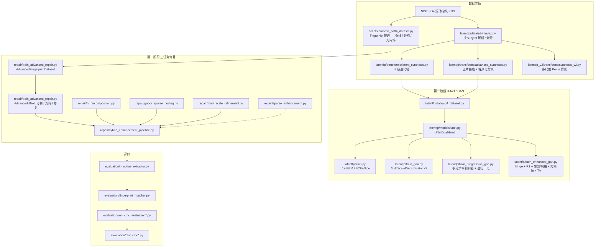

# 潜指纹增强 · 退化合成 + 双头 U-Net / 多尺度 GAN + TV–Gabor 稀疏表示

[English](README.en.md) | **简体中文**


> 潜指纹（latent fingerprint）是从现场提取的残缺、低对比度、带背景干扰的指纹；增强的目标是把
> 断断续续的脊线补全、把背景压下去，让后续细节点提取和比对能用。
>
> 本仓库是这条流水线的完整实现：**先用程序化退化从清晰滚动指纹合成训练对，再用 U-Net / GAN
> 学习「潜指纹 → 清晰脊线」的映射，最后用 TV 分解 + Gabor 字典稀疏表示做一层不依赖训练的
> 梯度域修正**，并用 SD4 的 Rank-k / CMC 曲线评估增强结果。

---

## 为什么这么做

潜指纹增强有三条互不相同的技术路线，各自的失败模式不一样。这个仓库把它们都实现了，是为了能
在同一份数据上直接对比，而不是因为哪一条"更好"：

| 路线 | 本仓库对应模块 | 能解决 | 解决不了 |
| --- | --- | --- | --- |
| 判别式回归（L1 / MSE） | `latentfp_v2/` | 脊线断裂、整体对比度 | 结果偏平滑，细节点附近的脊线宽度会糊掉 |
| 条件 GAN（PatchGAN 判别器） | `latentfp/train_gan.py` | 局部纹理锐度 | 训练不稳，容易在背景平坦区乱造纹理 |
| 多分辨率判别 + 感知/风格/方向场损失 | `latentfp/train_progressive_gan.py`、`latentfp/train_enhanced_gan.py` | 多尺度纹理一致性、高层语义相似度、脊线方向连续性 | 依赖 ImageNet 预训练 VGG，和灰度指纹域有偏移；方向场本身是梯度估计出来的，噪声区不可信 |
| 三任务联合 U-Net | `repair/train_advanced_repair.py` | 分割/方向场/修复互相约束，修复头不会在背景上造纹 | 需要 FingerNet 先产出分割和方向场标签 |
| 免训练梯度域方法 | `repair/tv_decomposition.py`、`repair/gabor_sparse_coding.py`、`repair/sparse_enhancement.py` | 不需要数据集，结果可控、可解释 | 很慢（每个 patch 一次 Lasso/OMP），且对参数敏感 |

**为什么一定要自己合成训练数据**：公开的真实潜指纹库（NIST SD27、CACD 等）只有几百张，且没有
像素级配对的"清晰真值"。所以这里走的是主流做法——拿 NIST SD4 的清晰滚动指纹当 `clean`，
用已知的退化模型（对比度压缩、伽马、运动模糊、高斯/乘性噪声、遮挡、暗角）合成 `latent`，
于是 `(latent, clean)` 天然成对，可以无限采样。

**为什么还要留一层非深度的方法**：GAN 的输出经常在脊线之间"脑补"出不存在的连接，而指纹比对
最怕的就是这种假细节点。TV 分解 + Gabor 字典稀疏表示这一层的作用是**只重建字典里存在的
方向/频率结构**，它在原理上不会凭空造出脊线，代价是很慢。两条路线的取舍写在下面的「已知局限」里。

---

## 架构



**数据流的关键点**：`repair/` 这一阶段不自己合成潜指纹，它吃的是 `scripts/process_sd04_dataset.py`
用 FingerNet 产出的四个对齐目录（`original/`、`enhanced_binary/`、`segmentation/`、`orientation/`）；
而 `latentfp/` 和 `latentfp_v2/` 是**在线合成**——每个 epoch 的 `latent` 都是新的随机退化，
等价于无限数据增强。

---

## 核心模块

### 落指纹合成（不用训练的部分）

| 模块 | 文件 | 职责 | 关键实现 |
| --- | --- | --- | --- |
| 退化链 v1 | `latentfp/transforms/latent_synthesis.py` | 把清晰指纹退化成潜指纹 | 8 步串联：对比度/亮度 → 伽马 → 高斯模糊 → 运动模糊 → 高斯噪声 → 乘性斑点噪声 → 矩形遮挡 → 暗角，最后整体压对比度 `α∈[0.5,0.9]`、`bias∈[-0.1,0.1]`；每步都由独立概率控制是否触发 |
| 脊线图 | 同上 `estimate_ridgemap` | 生成二值脊线骨架，作为辅助监督 | CLAHE(2.0, 8×8) → 3×3 高斯 → 自适应阈值(`GAUSSIAN_C`, blockSize 15, C=2, `THRESH_BINARY_INV`) → 形态学细化 |
| 正片叠底合成 | `latentfp/transforms/advanced_synthesis.py` | 模拟"手指压在复杂纹理物体上" | `multiply_blend` 逐像素相乘，配合程序化背景（均匀噪声 + 随机斜条纹 + 圆环 + 随机矩形块） |
| 退化链 v2 | `latentfp_v2/transforms/synthesis_v2.py` | 更温和、更稳定的版本 | 4 个尺度的随机噪声上采样叠加成类 Perlin 背景，再正片叠底、压对比度、轻度模糊与噪声 |
| 分块记账 | `latentfp/transforms/patch_ops.py` | 重叠 patch 的累加与平均 | 积分图无关的 `accumulate_patch` + `weighted_average`，未被任何 patch 覆盖的像素回退到原图 |
| SD4 索引 | `latentfp/data/sd4_index.py` | 文件名解析、配对、**按 subject 划分** | `f0001_01.png` → `("f","0001","01")`；`split_subjects` 用 `sha256(salt:seed)` 播种，保证同一 subject 的两个 impression 不会跨 train/val |

### 深度模型与训练损失

| 模块 | 文件 | 职责 | 关键实现 |
| --- | --- | --- | --- |
| 双头 U-Net | `latentfp/models/unet.py` | 主干生成器 | 4 层下采样（base 32→512），双线性上采样 + skip concat，两个 1×1 头：`restored`（logits）与 `ridge_logits` |
| 多尺度判别器 | `latentfp/models/discriminators.py` | PatchGAN | `MultiScaleDiscriminator` 在 1×、1/2、1/4 三个尺度各挂一个 `PatchDiscriminator`（4×4 卷积、stride 2） |
| 多分辨率判别器 | `latentfp/models/progressive_discriminators.py` | 更稳的判别器 | 全分辨率主路 + 1/2、1/4 两个小判别器，全部用 `spectral_norm`，**去掉了 BatchNorm**（小 batch 下更稳） |
| 基础回归 | `latentfp/train.py` | 消融基线 | `loss = [L1 + 0.2·SSIM] + 0.5·[BCE + 0.5·Dice]`，Adam 1e-3，CosineAnnealing，AMP |
| 条件 GAN | `latentfp/train_gan.py` | 第二个基线 | BCE-with-logits 对抗 + `λ_l1=100`、`λ_ssim=20`、`λ_ridge=1.0`；判别器输入是 `[latent, restored]` 两通道 concat |
| 多分辨率 GAN | `latentfp/train_progressive_gan.py` | 第三个基线 | 三个尺度的对抗损失**取平均**而不是相加 |
| 论文版增强 GAN | `latentfp/train_enhanced_gan.py` | 把所有技巧叠起来 | Hinge GAN + R1 梯度惩罚(`γ=10`) + VGG16 感知/风格 + 方向场损失 + TV + Dice；权重 `{l1:100, perceptual:10, style:10, orientation:5, tv:0.1, dice:10}`；D/G 各用一个 `GradScaler`；前 10% epoch 做对抗权重 warm-up；非有限损失整批跳过 |
| 感知 / 方向场损失 | `latentfp/losses/perceptual_loss.py` | 高层语义 + 几何约束 | `VGGPerceptualLoss` 取 VGG16 的第 4/9/16 层做 L1 + Gram 风格损失；`OrientationFieldLoss` 用 Sobel 求 `gx,gy`，15×15 均值平滑后 `θ = 0.5·atan2(2Gxy, Gxx−Gyy)`，再对两张方向场取 L1 并加一致性项 |
| 指标参考实现 | `latentfp/losses/metrics.py` | 可测的数学 | 积分图实现的 `box_filter`、`ssim_map/ssim_loss`、`dice_coefficient/dice_loss`、`psnr`、`normalize_weights`、`combine_losses`；torch 版本按需导入 |
| 单阶段回归 v2 | `latentfp_v2/models/enhance_unet.py` | 最简基线 | 结构与 v1 相同的 4 层 U-Net，上采样时按 skip 尺寸 pad；损失只有 `L1(sigmoid(rec), clean) + Dice(ridge_logits, ridge)` |
| 三任务修复网络 | `repair/train_advanced_repair.py` | 主模型 | 4 层编码 → 瓶颈处 `AttentionBlock`（通道压缩的 Q/K 自注意力 + 可学习 `γ` 残差）→ 共享解码 → 三个头：`segment`(Sigmoid)、`orient`(Tanh)、`repair`(Tanh)；损失 `200·BCE + 50·L1(orient) + 100·(L1 + 0.5·EdgeLoss)` |
| VGG 感知损失 | `repair/perceptual_loss.py` | 另一份感知损失实现 | 取 VGG16 的 relu1_2/relu2_2/relu3_3/relu4_3，先按通道 L2 归一化再算 L1；`EnhancedLoss = λ_mse·MSE + λ_p·perceptual` |

### 梯度域增强（TV + Gabor 稀疏表示）

| 模块 | 文件 | 职责 | 关键实现 |
| --- | --- | --- | --- |
| TV 分解 | `repair/tv_decomposition.py` | 把图拆成"结构/背景"和"纹理/脊线" | 三个实现：梯度下降版、ROF 版、以及按 `compute_coherence`（结构张量一致性 `√((Gxx−Gyy)²+4Gxy²)/(Gxx+Gyy)`）调 λ 的自适应版 |
| Gabor 字典 | `repair/gabor_sparse_coding.py` | 稀疏表示的字典 | **16 方向 × 9 波长(5…21 px) × 6 相位 = 864 个原子**；每个原子零均值 + L2 归一化；`Lasso`/`OMP` 编码，用 `fit_intercept=True` 吸收直流分量 |
| 多尺度稀疏编码 | 同上 `multi_scale_sparse_coding` | 论文式 (9) 的联合优化 | 把 `[Φ_s ; √γ·Φ_l]` 上下堆叠、`[y_s ; √γ·y_l]` 拼接后一次求解，再用**小字典**重建；`γ=0.8` |
| 多尺度迭代 | `repair/multi_scale_refinement.py` | 只重修低质量区域 | 用 `quality_assessment` 找一致性低的 patch，patch 边长 24→48 每轮 +4 |
| 混合流水线 | `repair/hybrid_enhancement_pipeline.py` | 把上面几步串起来 | `HybridFingerprintEnhancer.enhance(method=...)` 支持 `tv_only / unet_only / gabor_only / tv_gabor / unet_gabor / unet_tv_gabor / full`；`full` = TV → U-Net → 对比度拉伸 → 多尺度稀疏 → 迭代 refinement |
| 带方向引导的稀疏增强 | `repair/sparse_enhancement.py` | 更细的同一套方法 | 用结构张量估 patch 主方向、沿法向做 `cv2.remap` 剖面 + `rfft` 估波长，据此从 864 列里挑一个方向带 ±15°、波长带 ±2 px 的子字典，再做联合两尺度编码；附带稀疏系数分割 |

### 推理 / 评价

| 模块 | 文件 | 职责 | 关键实现 |
| --- | --- | --- | --- |
| 推理（v1） | `latentfp/infer.py` | 加载权重出三张图 | 兼容 `{"model":...}` / `{"generator":...}` / 裸 `state_dict` 三种 checkpoint；输出 `restored.png`、`ridge.png`、`ridge_bin.png`（Otsu） |
| 推理（v2） | `latentfp_v2/infer_v2.py` | 同上，更简 | `strict=False` 加载，同样输出三张图 |
| 批量推理 | `repair/inference_advanced.py` | 三任务模型的批量版 | 自动从 checkpoint 第一层权重推断 `base_channels`；按原始尺寸还原输出 |
| 输出与指标 | `repair/output.py` | 批量出图 + PSNR/SSIM | 用 `skimage.metrics` 算 PSNR/SSIM，可选 Otsu / 固定阈值二值化 |
| 二值化 | `repair/binarize_enhanced_images.py` | 增强图 → 纯黑白 | Otsu / 固定 / 自适应阈值 + 形态学 + 按分割掩码去掉边缘 |
| 细节点 | `evaluation/minutiae_extractor.py` | 端点 / 分叉点 | `skimage.morphology.thin` 骨架 → 8 邻域交叉数 `CN`；`CN==1` 端点、`CN==3` 分叉点；滤掉距边界 20 px 以内的点 |
| 匹配 | `evaluation/fingerprint_matcher.py` | 细节点比对 | `scipy.spatial.distance.cdist` 建代价矩阵 + `scipy.optimize.linear_sum_assignment`（匈牙利）求最优分配，`distance_threshold=20 px`、`angle_threshold=π/6`；`MatcherWithTransform` 额外做角度搜索 |
| CMC | `evaluation/run_cmc_evaluation{,_fast,_medium}.py` | Rank-k 曲线 | 每个 probe 与全部 gallery 逐个打分 → 排序 → 取真实匹配的排名 → 统计 Rank-k；带细节点 pkl 缓存 |
| 画图 | `evaluation/plot_cmc.py`、`plot_cmc_4panel.py` | CMC 曲线 | 从 JSON 结果出单图 / 四联图 |

---

## SD4 数据集怎么用

NIST Special Database 4 是 2000 对指纹：每对一张滚动（classifiable）十指印 + 一张对应的
**潜指纹**，命名共享四位 subject id 与两位 impression id：

```
f0001_01.png   # 滚动印（rolled / classifiable）
s0001_01.png   # 与之配对的潜指纹（latent / search）
```

本仓库对这个命名有两种用法：

1. **只要清晰图**（`latentfp/`、`latentfp_v2/`）
   把任意一份清晰指纹 PNG 目录丢给 `--data_root`，`SD4Fingerprints` 会 `rglob("*.png")`
   扫全部 PNG，随机裁 256（`train_enhanced_gan.py` 用的是 512；不足则 `BORDER_REFLECT_101`
   补齐），**在每个 batch 现场合成** latent 与 ridge-map。`latentfp/data/sd4_index.py` 额外
   提供文件名解析与**按 subject 的 train/val 划分**，避免同一根手指的两个 impression 同时
   出现在两边。
2. **要 4 个对齐目录**（`repair/`）
   `scripts/process_sd04_dataset.py` 拿 SD4 的 `png_txt/figs_*` 逐张跑 FingerNet，输出：

```
processed_sd04_dataset/
├── original/          # 输入：原始潜指纹
├── enhanced/          # FingerNet 相位图（脊线）
├── enhanced_binary/   # 二值化后的脊线，repair/ 的训练目标
├── segmentation/      # 前景掩码
├── orientation/       # 方向场（编码成 0-255 灰度可视化）
└── paired_list.txt
```

> ⚠️ `scripts/process_sd04_dataset.py` 依赖**第三方 FingerNet Keras 发布版**
> （`src/train_test_deploy.py`、`src/utils.py`、`models/released_version/Model.model`）。
> 这些文件受其原始许可约束，**不在本仓库内**，你需要自己准备一份 FingerNet 检出才能跑这个脚本。

---

## 快速开始

```bash
git clone https://github.com/DOUFUQAAQ/latent-fingerprint-enhancement.git
cd latent-fingerprint-enhancement
pip install -r requirements.txt          # 只跑测试的话 pip install numpy 就够
cp .env.example .env                     # 本仓库不含任何密钥，这里只是登记 GPU 选择
```

所有脚本都要从仓库根目录以**模块方式**运行（`repair/`、`evaluation/` 内部用的是包内绝对导入）：

```bash
# ① 基础回归：双头 U-Net，L1 + SSIM + BCE + Dice
python -m latentfp.train --data_root /path/to/clean_fingerprints --epochs 5 --batch_size 4

# ② 条件 GAN（多尺度 PatchGAN 判别器）
python -m latentfp.train_gan --data_root /path/to/clean_fingerprints --epochs 2

# ③ 多分辨率判别器 GAN
python -m latentfp.train_progressive_gan --data_root /path/to/clean_fingerprints --epochs 10

# ④ 论文版增强 GAN：hinge + R1 + 感知/风格 + 方向场 + TV
python -m latentfp.train_enhanced_gan --data_root /path/to/clean_fingerprints \
    --epochs 50 --batch_size 8 --lr 2e-4 --device cuda

# ⑤ 单阶段回归基线
python -m latentfp_v2.train_enhance_v2 --data_root /path/to/clean_fingerprints --epochs 5

# ⑥ 三任务修复网络（需要上面那 4 个对齐目录）
python -m repair.train_advanced_repair \
    --data_root /path/to/processed_sd04_dataset \
    --num_epochs 200 --batch_size 8 --image_size 256

# ⑦ 单张 / 批量推理
python -m latentfp.infer --input latent.png --ckpt checkpoint_unet_dualhead.pt --out_dir outputs
python -m repair.inference_advanced --checkpoint checkpoints_advanced/best_model.pth \
    --input_dir /path/to/images --output_dir results

# ⑧ 混合增强流水线（TV → U-Net → Gabor 稀疏 → 多尺度 refinement）
python -m repair.hybrid_enhancement_pipeline --input latent.png --output hybrid_results \
    --checkpoint checkpoints_advanced/best_model.pth --method full

# ⑨ CMC 评估
python -m evaluation.run_cmc_evaluation_fast
```

运行期真正读的环境变量只有 `CUDA_VISIBLE_DEVICES`，以及 CMC 脚本用的
`LATENTFP_DATASET_DIR` / `LATENTFP_PROPOSED_DIR` / `LATENTFP_GABOR_DIR` / `LATENTFP_STFT_DIR`
（`evaluation/` 里原先写死的本机绝对路径已改成这几项）。数据路径和超参数走命令行参数或源码
顶部的常量。

---

## 项目结构

```
latent-fingerprint-enhancement/
├── latentfp/                      # 第一阶段：合成 + 双头 U-Net / GAN（PyTorch）
│   ├── data/
│   │   ├── sd4_dataset.py         # torch Dataset：读图 → 裁切 → 合成 → 张量
│   │   └── sd4_index.py           # 文件名解析 / 配对 / 按 subject 划分（纯标准库）
│   ├── transforms/
│   │   ├── latent_synthesis.py    # 8 级退化链 + 脊线图
│   │   ├── advanced_synthesis.py  # 正片叠底 + 程序化复杂背景
│   │   └── patch_ops.py           # 重叠 patch 累加与平均（纯 numpy）
│   ├── models/
│   │   ├── unet.py                # UNetDualHead
│   │   ├── discriminators.py      # PatchDiscriminator / MultiScaleDiscriminator
│   │   └── progressive_discriminators.py
│   ├── losses/
│   │   ├── perceptual_loss.py     # VGG 感知/风格 + 方向场 + TV 损失
│   │   ├── metrics.py             # SSIM / Dice / PSNR / 损失权重（numpy + torch）
│   │   └── __init__.py
│   ├── train.py                   # L1 + SSIM / BCE + Dice
│   ├── train_gan.py               # 条件 GAN
│   ├── train_progressive_gan.py   # 多分辨率判别器 GAN
│   ├── train_enhanced_gan.py      # 论文版增强 GAN
│   └── infer.py
├── latentfp_v2/                   # 第二阶段：单阶段回归基线
│   ├── data/enhance_dataset.py
│   ├── models/enhance_unet.py
│   ├── transforms/synthesis_v2.py
│   ├── train_enhance_v2.py
│   └── infer_v2.py
├── repair/                        # 第三阶段：三任务 U-Net + 梯度域增强
│   ├── train_advanced_repair.py   # AdvancedUNet（分割/方向/修复）+ 训练循环
│   ├── train_fingerprint_repair.py
│   ├── train_with_augmentation.py
│   ├── train_ultimate.py
│   ├── train_large_model.py
│   ├── perceptual_loss.py
│   ├── tv_decomposition.py
│   ├── gabor_sparse_coding.py
│   ├── multi_scale_refinement.py
│   ├── sparse_enhancement.py
│   ├── hybrid_enhancement_pipeline.py
│   ├── inference_advanced.py
│   ├── output.py
│   ├── quick_test_model.py
│   ├── binarize_enhanced_images.py
│   └── save_best_method.py
├── evaluation/                    # 第四阶段：细节点 / 匹配 / CMC
│   ├── minutiae_extractor.py
│   ├── fingerprint_matcher.py
│   ├── run_cmc_evaluation.py
│   ├── run_cmc_evaluation_medium.py
│   ├── run_cmc_evaluation_fast.py
│   ├── test_cmc_system.py
│   ├── plot_cmc.py
│   └── plot_cmc_4panel.py
├── scripts/
│   └── process_sd04_dataset.py    # 用第三方 FingerNet 生成 4 个对齐目录
├── tests/                         # numpy 单测（torch/cv2 相关自动跳过）
│   ├── test_sd4_index.py
│   ├── test_patch_ops.py
│   ├── test_metrics.py
│   ├── test_latent_synthesis.py
│   ├── test_synthesis_and_tv.py
│   └── test_gabor_dictionary.py
├── conftest.py
├── pytest.ini
├── requirements.txt
├── requirements-dev.txt
├── .env.example
└── .github/workflows/ci.yml
```

---

## 测试

测试只依赖 **numpy + 标准库**，在没有 torch / OpenCV / scikit-learn 的机器上也必须全绿；
涉及重库的用例用 `unittest.skipUnless` 跳过。

```bash
python -m unittest discover -s tests -t .      # 标准库方式
python -m pytest -q                            # pytest 也能跑（conftest.py 已把根目录加进 sys.path）
```

覆盖的内容：

| 测试文件 | 覆盖对象 | 断言的核心性质 |
| --- | --- | --- |
| `test_sd4_index.py` | `latentfp/data/sd4_index.py` | 文件名解析正/负例、`f/s` 前缀映射、`index_sd4_dir` 跳过非 SD4 文件、**按 subject 划分互不相交且并集完整**、同一 subject 的两种印迹同侧、种子可复现 |
| `test_patch_ops.py` | `latentfp/transforms/patch_ops.py` | 滑窗位置只出完整 patch、覆盖计数守恒、重叠 patch 平均不是求和、未覆盖像素回退、越界/形状错误抛异常 |
| `test_metrics.py` | `latentfp/losses/metrics.py` | `box_filter` 与朴素循环逐点一致、同图 SSIM=1、噪声越大 SSIM 越低、Dice 的 0/1/0.5 三个端点、PSNR 解析解、`normalize_weights` 归一化、`combine_losses` 的缺权重/多权重/NaN 报错、torch 版与 numpy 版一致 |
| `test_latent_synthesis.py` | `latentfp/transforms/{latent_synthesis,advanced_synthesis}.py` | `_ensure_float01` 的 1/255 缩放语义、`p=0` 时算子严格恒等、`gamma=2` 即平方、暗角只压边缘不压中心、输出恒在 `[0,1]` |
| `test_synthesis_and_tv.py` | `latentfp_v2/transforms/synthesis_v2.py`、`repair/tv_decomposition.py` | 正片叠底结果不超过前景、常量图纹理为 0、ROF 分解满足 `cartoon + texture − 255 == image`、λ 越大越平滑、输出恒在 uint8 范围 |
| `test_gabor_dictionary.py` | `repair/gabor_sparse_coding.py`、`repair/sparse_enhancement.py` | 核尺寸严格 `size×size`、864 原子计数、每列零均值且 L2 归一化、构造可复现、`reconstruct_patch` 往返一致、稀疏度阈值语义 |

当前结果：**133 个用例全部通过，11 个因缺 OpenCV / scikit-learn 而跳过**。

---

## 已知局限 / 已知问题

这一节是**实测**出来的问题清单，不是免责声明。

### 数据与可复现性

1. **没有发布任何权重和数据。** NIST SD04 有分发许可限制，训练好的 `.pth` 也很大；仓库里
   只有代码。想复现 `repair/` 的训练必须先自备 SD4 + 第三方 FingerNet 权重。
2. **`--data_root` 的语义在不同阶段不一样**：`latentfp/`、`latentfp_v2/` 要的是"一堆清晰指纹
   PNG"（递归扫 `*.png`），`repair/` 要的是 `original/ + enhanced_binary/ + segmentation/ +
   orientation/` 四个对齐目录。传错会直接 `FileNotFoundError`，没有友好提示。
3. **目录名对不上**：`scripts/process_sd04_dataset.py` 写出的是 `enhanced/`，而
   `repair/train_advanced_repair.py` 读的是 `enhanced_binary/`。中间那一步二值化
   （`repair/binarize_enhanced_images.py` 或等价脚本）在原始工程里是单独跑的，仓库里没有把它串进流程。
4. **数据泄漏是真实存在的，而且只修了一半。** `repair/train_advanced_repair.py` 对
   `sorted(glob(...))` 直接做 80/20 前缀切分。SD4 的文件名排序是"先全部 `f*` 再全部 `s*`"，
   所以这个前缀切分会把某个 subject 的滚动印放进训练集、把它的潜指纹放进验证集——正好是
   subject 划分最不该出现的情况。`latentfp/train.py` 用的 `random_split` 是按文件随机切，
   同样会泄漏。`latentfp/data/sd4_index.py` 实现了正确的按 subject 划分并且有单测覆盖，
   但**还没有接进训练脚本**。
5. **`latentfp/train_enhanced_gan.py` 的"验证"跑在训练用的 dataloader 上**
   （`for batch in dataloader:`），所以它打印的 `Val` 其实是训练损失，不能用来判断过拟合。

### 算法与实现

6. **"渐进式 GAN"名不副实。** `ProgressivePatchDiscriminator` 做的是"多分辨率判别器集成"，
   不是 ProgressiveGAN 那种逐层淡入（fade-in）的渐进生长。文件名沿用旧习惯，容易误解。
7. **`repair/tv_decomposition.py` 里两个 TV 实现的 λ 语义相反**：`rudin_osher_fatemi_tv` 用
   `u += dt·(div − (u−img)/λ)`（λ 越大越平滑，正常），而 `tv_decomposition` 用
   `u += τ·(λ·div − (u−img))`（λ 直接放大 TV 项）。后者在纹理图上会冲出 `[0,1]`，被 uint8
   截断后 `cartoon + texture − 255 ≠ image`。测试里只对前者断言了可加性，后者只断言常量图稳定性。
8. **`TVDecomposition.decompose`（`repair/sparse_enhancement.py`）不是标准的 ROF 迭代**：
   `u = (image + λ·div) / (1 + λ)` 每轮都从 `image` 重算，不动点会整体衰减到
   `image/(1+λ)`，也就是连平坦区域的纹理也不为 0。它保留是因为下游按这个语义调过参。
9. **`latentfp/transforms/latent_synthesis.py::_ensure_float01` 的缩放是全局的**：只要
   `img.max() > 1`，整张图都除以 255；一张混了 `0-1` 和 `0-255` 值的数组会被静默错误缩放
   （`test_latent_synthesis.py` 里把这个行为钉成了断言）。
10. **`LAMBDA_EDGE = 20.0` 是死代码**（`train_advanced_repair.py`）：`CombinedLoss` 里
    边缘损失写死成 `0.5 · loss_edge`，这个常量既没参与计算也没打印。
11. **`VGGPerceptualLoss`（`latentfp/losses/perceptual_loss.py`）建了 4 个 slice 却只用 3 个**，
    `slice4` 是残留下来的空壳。
12. **`models.vgg16(pretrained=True)`** 在 torchvision ≥ 0.13 已弃用（应写
    `weights=VGG16_Weights.IMAGENET1K_V1`），在新版本上只会告警、不会失败，但迟早会。
13. **`hybrid_enhancement_pipeline.py::postprocess_from_unet` 对三个头套用同一个
    `(img+1)/2` 反归一化**，而 `segment` 头本身是 `Sigmoid` 输出 `[0,1]`，所以它的可视化是错的
    （`repair`/`orient` 是 `Tanh`，反归一化才对）。修复流程本身只用 `repair` 头，不影响主结果。
14. **`gabor_sparse_coding.py` 的 `lambda_reg` 被内部乘了 0.01**（`adjusted_lambda =
    lambda_reg * 0.01`），所以命令行传 `--lambda_reg 0.5` 实际生效的是 0.005。文档里写
    "论文推荐 0.5"，但它和论文的 λ 不是同一个尺度。
15. **整个 `repair/` 的稀疏编码是逐 patch 串行求解的**，一张 256×256、patch 24、stride 8 的图
    有 29×29=841 个 patch，每个跑一次 `Lasso`，CPU 上是分钟级。没有任何并行/批量化。
16. **混合流水线的命令行漏了 `unet_tv_gabor`。** `HybridFingerprintEnhancer` 实现了这个方法，
    但 `argparse` 的 `choices` 里没有它，所以只能从 Python 里调，命令行选不到。
17. **`evaluation/run_cmc_evaluation*.py` 里写死了 `matplotlib.rcParams['font.sans-serif'] =
    ['SimHei']`**（Windows 才有的中文字体）。在 Linux 上中文标签会变成方块，需要装 CJK 字体
    再改这行。
18. **非 ASCII 输出在 Windows 中文控制台会炸。** 多个脚本里 `print` 了 `✓`/`✗`/`⚠`，
    在 cp936 代码页下抛 `UnicodeEncodeError`（测试里靠重定向 stdout 规避）。
    临时办法：`set PYTHONIOENCODING=utf-8`。

### 第三方代码边界（重要）

19. **骨干网络参考了 FingerNet。** 本仓库**不包含** FingerNet 的任何源码或权重；只有
    `scripts/process_sd04_dataset.py` 在运行期去 import 一份外部的 FingerNet 检出
    （`train_test_deploy.get_main_net` / `utils.mkdir` / `Model.model`）。`repair/` 里
    三任务 U-Net 的**标签**（相位脊线图、分割掩码、方向场）也是 FingerNet 产出的，
    所以 `repair/` 的上限受 FingerNet 本身限制。
20. **仓库里没有任何 CMC / PSNR / SSIM 的实测数字。** 原始工程里出现过 Rank-1 ≈ 78%、
    PSNR > 28 dB 之类的说法，但那些数字来自不同的数据集切分和不同的对比脚本，我**没有**
    在本仓库里复现过，因此不写进 README。
21. `evaluation/` 里 CMC 对比的 "Proposed / Gabor / STFT / Original" 四种方法，其增强输出在原始
    工程里来自另外三个第三方仓库（FingerGAN、Gabor enhancer、STFT enhancer）。这些仓库**没有**
    拷进本仓库；`run_cmc_evaluation*.py` 只负责"给定若干已增强的目录，算 CMC"，对比方法要你自己准备。

---

## Roadmap

- [ ] 把 `latentfp/data/sd4_index.py` 的按 subject 划分接进 `latentfp/train*.py`，替掉
      `random_split`（并修掉 `train_enhanced_gan.py` 的验证集泄漏）
- [ ] 统一 `repair/` 的数据目录约定（`enhanced/` vs `enhanced_binary/`），把二值化步骤串进 pipeline
- [ ] 修正 `tv_decomposition()` 的 λ 语义，让它和 `rudin_osher_fatemi_tv()` 一致
- [ ] 给 `postprocess_from_unet` 按 head 区分反归一化
- [ ] 稀疏编码批量化（一次 `sklearn` 调用求解整个 patch 批次），或换成 torch 的 ISTA/FISTA
- [ ] 把逐 patch 的 `print`/`tqdm` 换成 `logging`，并统一 ASCII-safe 输出
- [ ] 补一个最小可跑的通路：`pytest` 里用 8 张 64×64 的合成图跑通 `UNetDualHead` 前向 + 一次反传
- [ ] 出一份 `docs/benchmark.md`，在固定切分上记录各方法的 Rank-1/Rank-10（需要先解决第 1 条）
- [ ] 提供 `Dockerfile`，把 OpenCV / scikit-learn 的版本钉死

---

## 许可与致谢

代码以 [MIT](LICENSE) 发布，Copyright (c) 2026 DOUFUQAQ。

实现过程中参考了以下工作（**只有公开论文，没有拷贝它们的代码**）：

- FingerNet — *An Universal Deep Convolutional Network for Extracting Fingerprint Representation*：
  本仓库的三任务标签生成依赖它的发布版（外部依赖，未随仓库分发）。
- Liu et al. — *Latent Fingerprint Enhancement via Multi-Scale Patch Based Sparse
  Representation*：`repair/gabor_sparse_coding.py`、`repair/sparse_enhancement.py` 的
  多尺度稀疏编码公式 (3)(4)-(9) 出自这篇。
- NIST Special Database 4：数据来源，受 NIST 分发条款约束。

数据集与第三方模型权重**不在**本仓库内，使用前请自行确认各自的许可。
